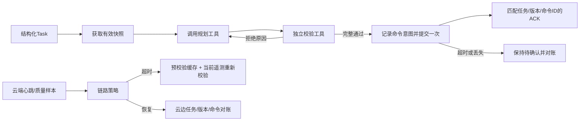

# M3：任务决策内核与云边决策

> **2026-11-10更新**：已增加M2真实代码适配、任务草稿确认、MaaS接口、SQLite/RDS任务台账、DCS状态投影、OBS归档与云侧MQTT基础代码。
> 最新运行方式、依赖、尚未完成项见[基础接入与下一步](../docs/M3_2026-11-10基础接入与下一步.md)。云服务和PX4尚未联通。

决策内核独立于前端、PX4、FastAPI和云资源；`planning.py`通过适配调用现有M2算法，云相关代码不负责创建资源。公共数据契约以 `core/models.py` 为准。

核心是**规则驱动、根据工具结果分支的决策内核**。工具结果会决定重取快照、带拒绝原因重规划、等待确认或停止。任务草稿确认、MaaS接口、真实M2代码适配与云侧消息基础已提供；真实模型/云服务/执行端仍待连接，不能称作已完成全部功能的AI Agent。

## 直接运行

仓库根目录，在本机已配置的 PowerShell 中：

```powershell
.\.venv\Scripts\python.exe -m agent.demo --scenario all
.\.venv\Scripts\python.exe -m pytest tests/test_agent.py tests/test_agent_recovery.py
```

只演示“校验拒绝后重规划”：

```powershell
.\.venv\Scripts\python.exe -m agent.demo --scenario replan
```

日志和汇总写到 `logs/agent/<批次>/`，该目录已被原有 `.gitignore` 排除。每个演示日志、汇总文件名与记录都带 MOCK 标识；测试数值不是任何机型参数，不进入效果评测。

离线回放某个日志：

```powershell
.\.venv\Scripts\python.exe -m agent.replay "logs/agent/<批次>/replan_MOCK.jsonl"
```

回放只检查事件序号、任务/运行标识和工具开始/结束记录，**不会重新执行工具**。它能提示中途崩溃留下的未完成调用；它不证明日志未被人为篡改，不自动恢复进程状态。

## 目录和本次成果

| 文件 | 作用 |
|---|---|
| `contracts.py` | M3自身的策略、规划请求、独立校验回执、工具接口与结果；复用公共Task/RoutePlan/PlanCommand/PlanAck |
| `engine.py` | 有限重试的任务状态机，拒绝原因回传规划器、快照更新、命令有效期与ACK处理 |
| `guards.py` | 跨工具的身份/版本/时效检查，不替代M2空间与能量校验 |
| `audit.py` | 追加JSONL，调用前后留输入/输出；先落命令意图再提交，写盘失败阻止提交 |
| `recovery.py` | 从审计恢复同一任务与命令的确认状态，不重放工具；崩溃中断保持结果未知 |
| `cache.py` / `storage.py` | 原子JSON缓存、内容校验和、乐观版本检查、进程写锁与Windows/Linux文件操作 |
| `link.py` | 云端心跳超时、质量退化、连续恢复样本与恢复后需对账标记；阈值可配置 |
| `edge_decisions.py` | 本地缓存路线选择、当前遥测重新校验、云端恢复对账；不发飞行命令 |
| `fixtures.py` / `demo.py` | 标明MOCK的可复现联调案例；没有重新实现队友算法 |
| `replay.py` | JSONL结构检查和离线状态/决策摘要 |



## 主状态机的规则

1. `Task` 必须结构完整，不猜能量、坐标或机型。核心入口接收结构化对象；`intake.confirm()`将已审核草稿转换为Task，页面确认交互仍待M5接入。
2. 拒绝未来采集、过期或无时区的快照；最多额外刷新一次，可通过 `AgentPolicy` 配置。
3. 同一次任务运行的计划版本依次为 `v1/v2/v3`，最多三次规划。下一次请求包含实际独立校验的失败项。
4. 不采用规划器自己的 `RoutePlan.checks` 作为授权依据。独立回执须包含 `restriction_zone`、`clearance`、`diversion_reachability`、`energy`，任务有时限时还须包含 `time_limit`；不得缺失、重名或缺少解释，全部检查通过。
5. 回执绑定 `task_id/route_id/plan_version/snapshot_id` 与整条候选路线的SHA256摘要；同名但内容变化的路线不能套用旧回执。
6. 校验后再次检查快照、任务和路线时效。命令有效期取策略TTL、路线有效期、快照有效期的最早值。失效时刻本身也按过期处理。
7. **先持久记录命令意图，再提交一次。**提交异常/超时不代表对端未收到，因此保留 `waiting_ack`，不自动生成新命令或重发。
8. ACK必须匹配命令ID、任务ID、版本及有效时间。重复ACK不会再次提交。`acknowledged` 仅表示命令被接受，**不表示飞行完成或配送成功**。

每个 `TaskAgent` 实例处理一个运行。相同日志由进程写锁保护，方法调用及同一进程的ACK处理串行化。使用上下文管理器或`close()`释放文件资源。不同日志间的任务去重由新增`TaskService`与持久台账提供；直接新建TaskAgent不具备这层保障。不要另建日志重新 `run()` 来猜测上一次提交是否成功。

## 重启恢复与缓存

进程停止后，从原审计恢复待确认命令，接收原命令的真实ACK；恢复不会重新调用任何工具：

```python
with TaskAgent.restore(team_tools, Path("logs/agent/task-run.jsonl")) as recovered:
    pending = recovered.result
    # 通过执行适配层查询原command_id的状态；拿到实际ACK后：
    # recovered.accept_ack(ack)
```

恢复保留任务ID、run_id、计划版本、原命令ID和已经持久记录的ACK。只有命令意图而无法确定是否发送时，保持`waiting_ack`；命令意图之前中断的运行变为`blocked`。过期命令不会自动换ID重发；迟到ACK只有其接收时间位于原命令有效期内才可接受。

损坏日志默认拒绝恢复。如确认最后一行因崩溃写了一半，可显式传`repair_tail=True`，先将残片保存为旁边的`.partial-*`文件，再移除残行。中间行损坏、混用MOCK/真实工具和时钟倒退不允许修复绕过。恢复是本地单任务的状态重建，不是跨服务事务或任意执行点checkpoint。

本地备用路线缓存示例：

```python
from agent.cache import FallbackCache

mode = "mock" if team_tools.is_mock else "integration"
cache = FallbackCache(Path("logs/agent/task-fallback.json"))
# candidate由上层提供，含独立校验回执、基础版本和相同run_mode。
written = cache.save(task, [candidate], run_mode=mode, expected_revision=0)
loaded = cache.load(task_id=task.task_id, run_mode=mode)
# 将loaded.candidates交给EdgeDecisionAgent.choose_fallback重新核对当前状态。
# 后续替换时传expected_revision=written.revision，避免覆盖别人的新缓存。
```

缓存使用同目录临时文件、写盘与原子替换；替换失败保留之前版本。摘要用于发现意外编辑，不能证明来源身份。缓存载入不授权执行，过期缓存即使成功读出也必须经决策模块拒绝。

## 与队友的四个工具接口

`AgentTools` 是 Python Protocol，不要求安装特定Agent框架。实现以下四个方法即可注入 `TaskAgent`：

| 工具 | 输入 | 输出 | 对接要求 |
|---|---|---|---|
| `get_snapshot` | 公共`Task` | 公共`RiskSnapshot` | 给出快照ID和时间基准，不能在后台悄悄换内容但保留ID |
| `plan_route` | `PlanningRequest` | `PlanningResult` | 接收指定版本、快照和失败反馈；无路线时给原因，不能编能量预算 |
| `verify_route` | `VerificationRequest` | `ValidationReport` | 独立复算；用`route_digest(request.route)`绑定输入；当前状态校验还要回传`vehicle_state_ts` |
| `submit_command` | 公共`PlanCommand` | 公共`PlanAck`或`None` | 只提交一次，传输层配置有限超时；对端按`command_id`去重，不能凭发送成功伪造ACK |

```python
from pathlib import Path
from agent.engine import TaskAgent

# team_tools实现上表接口；task是core.models.Task。
# 真实实现接入后再设置team_tools.is_mock=False。
with TaskAgent(team_tools, Path("logs/agent/task-run.jsonl")) as agent:
    result = agent.run(task)
    # 传输层稍后收到ACK时：agent.accept_ack(ack)
```

`planning.M2Tools`现已调用已有A*和独立校验器。机型参数仍缺失时明确阻止规划，不能靠填造预算/校验结果来“接通”。现有几何基线尚不能根据校验反馈动态改线，拒绝后会停止。`is_mock=False`只标识适配器声明，不自动证明它是真实数据、真实飞控或云服务。

## 链路与本地备用方案

- `CloudLinkMonitor` 只消费云端通道心跳的接收时间和RTT/丢包样本。**不把云端超时当作PX4连接中断**。默认5秒心跳超时、300ms RTT、10%丢包是示例阈值，需要用实际网络观测调整。
- 连续健康样本满足恢复条件后仍保留 `requires_reconciliation`；上层完成`decision = edge.reconcile(...)`后，用`monitor.mark_reconciled(decision, task_id=task.task_id)`清除标记，该方法拒绝对账失败或任务不符的结果。
- `choose_fallback()` 输入预校验缓存和带任务ID的当前遥测。先筛过期/错任务/错基础版本/回执不符的缓存，再用**本地**校验工具按当前位置、电量和时间重新校验。
- 当前能量未知、遥测过期或当前状态校验不可用时，返回 `no_valid_fallback`，交给既有飞控保护/飞手策略；这里不擅自下达悬停、返航或降落命令。
- 选中缓存只返回 `select_cached_route` 和回执，不调用规划工具、云端服务或飞控。这叫**本地备用路线选择**，不叫边缘实时重规划。
- 对账需要带 `task_id/accepted_command_id` 的边缘遥测信封，因为公共 `VehicleState` 本身没有任务ID。任务、执行版本或命令ID不一致时返回 `reconcile_required`，不覆盖状态、不重发计划。
- 候选缓存可用`FallbackCache`保存/载入；MOCK缓存不允许被真实适配器使用，备用路线的`vN`版本必须比基础计划更新。已提供云侧MQTT适配，但真实网络故障注入、执行端与飞控保护策略尚未接入；当前M2适配也明确拒绝其尚不支持的当前状态剩余路线校验。
- 每个`EdgeDecisionAgent`及其审计文件只处理同一个任务，可记录该任务的多次决策；不同任务使用独立实例与日志，避免混合证据。

## 十一个可运行的演示

| `--scenario` | 演示什么 | 应得到的状态 |
|---|---|---|
| `normal` | 独立回执完整通过、收到匹配ACK | `acknowledged` |
| `replan` | 首次备降检查失败，带反馈改为v2 | `acknowledged`，规划两次、提交一次 |
| `stale` | 首份快照过期，重取后再规划 | `acknowledged` |
| `no_route` | 规划工具明确无路线 | `blocked`，不提交 |
| `missing_check` | 缺少独立能量检查，有限重试 | `blocked`，不提交 |
| `ack_timeout` | 响应超时，不知道对端是否接收 | `waiting_ack`，仅提交一次 |
| `mismatched_ack` | ACK版本不匹配 | `waiting_ack` |
| `fallback` | 缓存初检、当前遥测重新校验、选路线 | `select_cached_route`，不发飞行命令 |
| `reconnect` | 云端v2、边缘v1 | `reconcile_required`，不自动覆盖 |
| `recovery` | 提交超时后关闭并恢复原任务，处理原命令的ACK | `acknowledged`，整个过程只提交一次 |
| `cached_fallback` | 原子保存、重新载入缓存，再按当前状态校验 | `select_cached_route`，不发飞行命令 |

## 依赖和验证边界

本机已建立 `.venv`。原有内核演示使用`requirements.txt`；新增接入层使用`requirements-m3.txt`，开发机已安装。Ruff仅用于静态检查，不是运行依赖。

```powershell
.\.venv\Scripts\python.exe -m pytest
.\.venv\Scripts\python.exe -m ruff check agent tests/test_agent.py tests/test_agent_recovery.py
```

可以写进开发记录：**完成M3规则决策内核、云边决策接口和可选基础接入层，通过本地控制流程与异常分支测试；真实云/执行端联调待完成。**

仓库提供GitHub Actions工作流，针对Python 3.11/3.13与Windows/Linux运行完整测试、M3静态检查和命令行演示；具体远端运行结果以Actions页面为准。

当前不能写成：完成M3全部功能、真实模型服务已联通、云边真实断连通过、PX4在环通过、备降安全性提升、实际配送完成。后续需完成M2动态规划/剩余路线校验、真实MaaS/云服务、常驻消息分发和实际执行回执联调。
